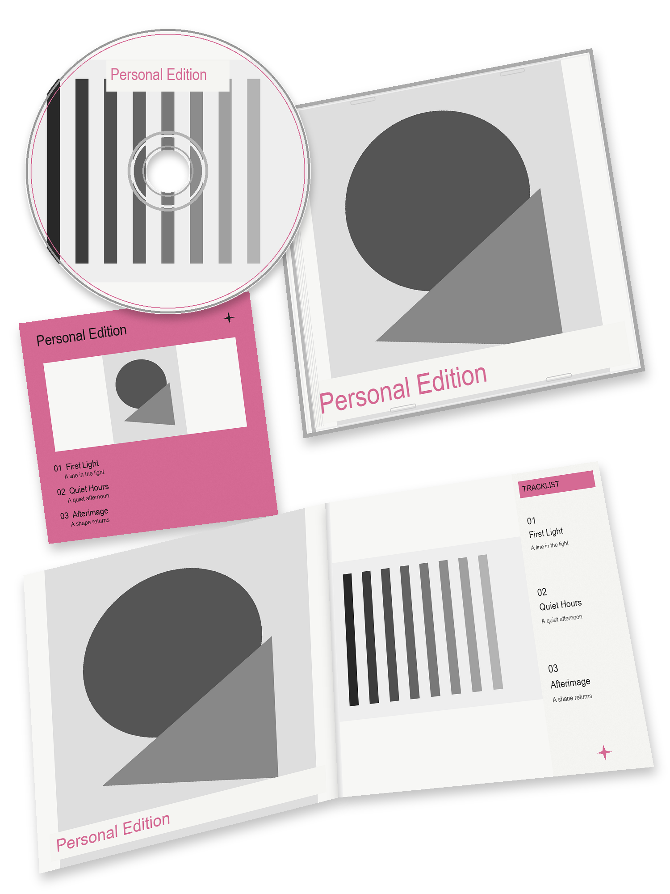

# Personal CD Edition

固定单张 3:4 个人 CD 套装，原片合成，黑白照片搭配一种素材相关专色。

四个位置固定为左上 CD、右上专辑封面、左中图文歌词卡、下方展开图集与歌名。CD 使用确认无真人脸的素材局部，缺少合适素材时使用纯几何抽象盘面。

本版使用 Python 合成原片。需要 Python 3.10+、Pillow 和 numpy；也支持具备原片贴合能力的图层工具。仅支持整图生成的平台无法执行严格的主体保留要求。

下载仓库中的 personal-cd-edition.zip，解压后用 personal-cd-edition 文件夹整体替换旧版，上传照片后输入：

> 用 $personal-cd-edition 做固定单张 CD 套装。

[下载固定版](https://github.com/1NWZ/personal-cd-edition/raw/refs/heads/main/personal-cd-edition.zip) · [技能说明](SKILL.md) · [配置格式](manifest.md) · [渲染脚本](render.py) · [MIT License](LICENSE)

旧版的多种排版和空白模板不再用于本版执行。重新安装时请替换整个技能文件夹。
