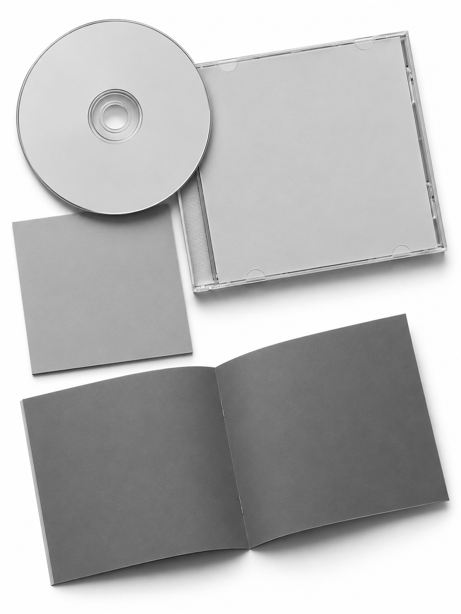
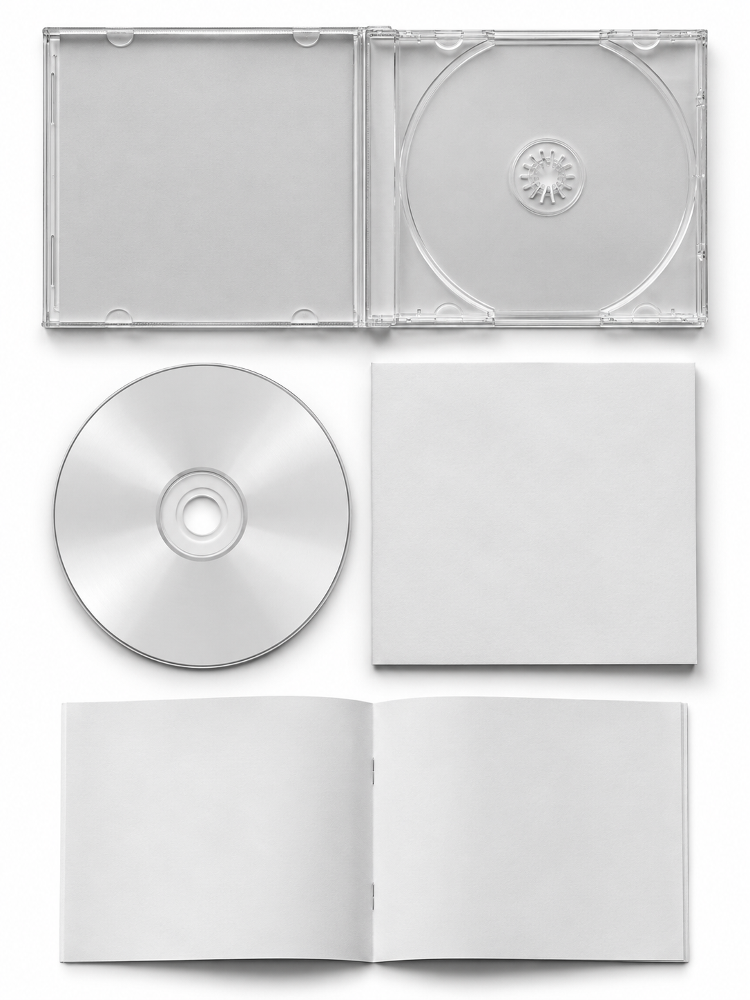
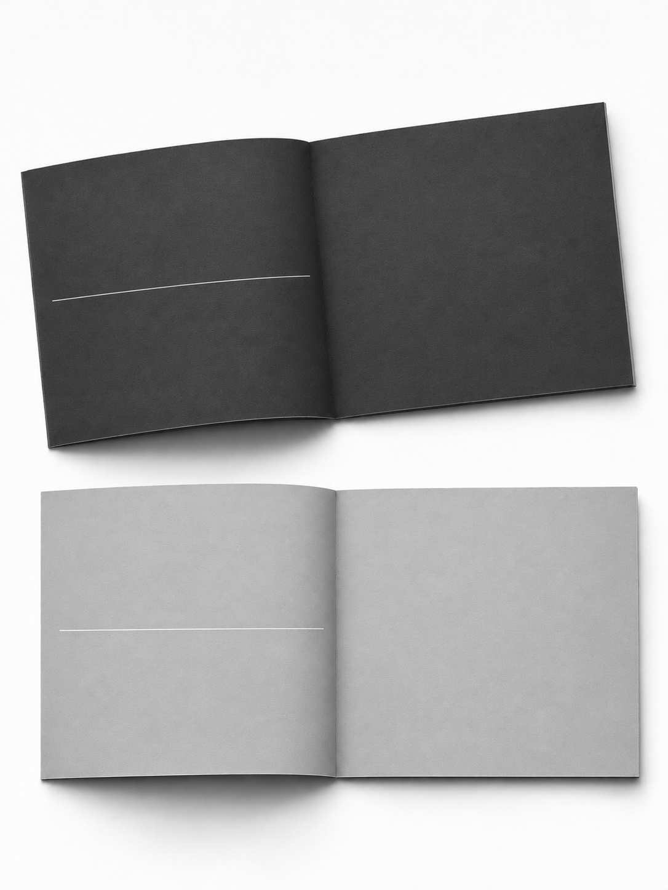
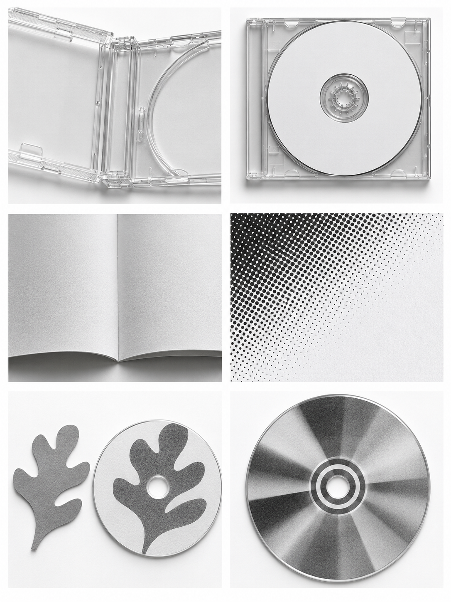
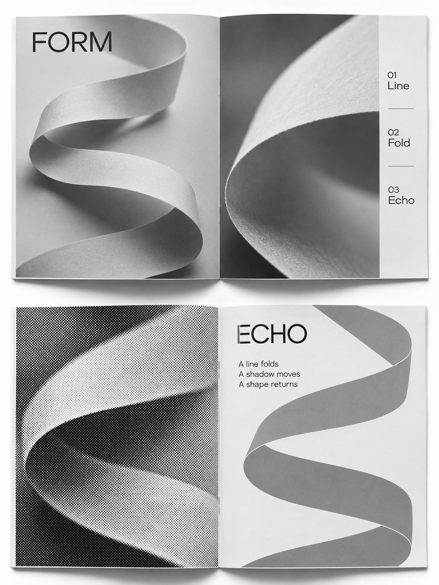

# Personal CD Edition

把个人照片做成 1–3 张独立 3:4 CD 周边图，从内容照片选择统一的荧光主色。包含三张灰度版式模板和一张材质与图案关系参考。需要支持参考图片的图像生成或编辑工具。

## 使用

将整个仓库放入个人技能目录下的 personal-cd-edition 文件夹，保留 PNG 参考文件。

> 用 $personal-cd-edition 做两张组图，颜色取自我的照片。

> 用 $personal-cd-edition 做一张掌心唱片，按参考 04。

掌心模式可上传清晰张开的手掌照。其他内容默认保留可辨认的主体及原有状态，用户可指定创意变化。

## 参考图

灰度区域是可替换印刷面。调用工具时实际附上本次原图及对应模板，参考图用来控制包装构图与材质。各平台的输入支持和编辑能力会影响结果。

[技能说明](SKILL.md) · [参考用法](design.md) · [MIT License](LICENSE)

## 完成态内页参考

技能要求在生成前为每件周边分配内容，逐一检查所有展开页是否完成源自用户素材的图文排版。
